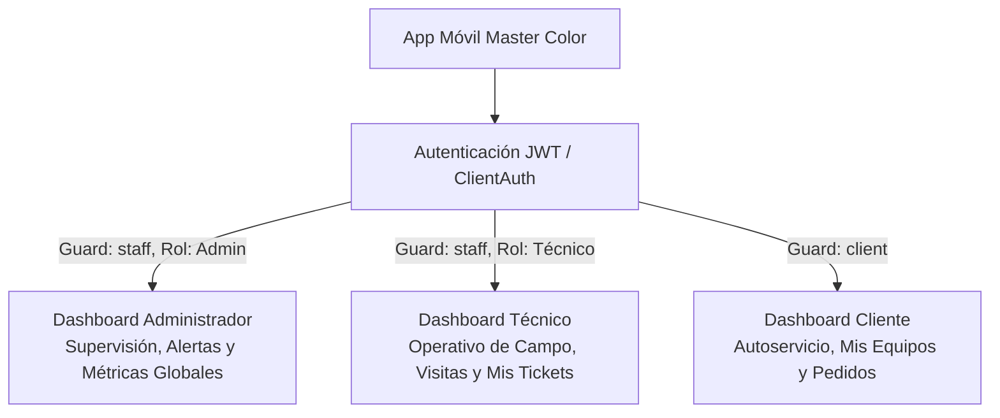

# Arquitectura y Especificación Técnica — Dashboards de Master Color

> **Fecha:** 2026-10-21  
> **Origen:** Mockups WhatsApp (`WhatsApp Image 2026-10-15 at 9.24.49 PM.jpeg` y `WhatsApp Image 2026-06-12 at 7.55.59 AM.jpeg`).  
> **Proyectos involucrados:**
> - `master_color_api` (Backend Laravel 12 / PHP 8.3 / PostgreSQL)
> - `master_color_appmovil` (Flutter / Riverpod / GoRouter / Material 3)

---

## 1. Visión General de la Solución

El sistema cuenta con tres paneles de control optimizados y adaptados para la experiencia en dispositivos móviles y web, segmentados según el rol del usuario autenticado:



---

## 2. Especificación de Endpoints (Backend Laravel)

### 2.1 Dashboard Administrador: `GET /api/support/dashboard/admin`
* **Controlador:** `App\Http\Controllers\SupportDashboardController@admin`
* **Servicio:** `App\Services\SupportDashboardService@getAdminDashboard`
* **Middleware:** `jwt.auth`, `check.token.version`
* **Parámetros query opcionales:**
  * `month` (int, ej. `4` para Abril)
  * `year` (int, ej. `2026`)
* **Contenido devuelto:**
  * **8 KPIs** con valor actual, valor anterior, `% de variación`, dirección (`up` / `down` / `neutral`), favorabilidad (`is_favorable`) y etiqueta de periodo (`vs. mes anterior`):
    1. `total_tickets`: Total de tickets creados en el periodo.
    2. `open_tickets`: Tickets activos/abiertos en el periodo.
    3. `unassigned_tickets`: Tickets sin técnico asignado (menor es favorable).
    4. `in_process_tickets`: Tickets en atención técnica directa.
    5. `resolved_this_month`: Tickets resueltos en el periodo.
    6. `sla_breached`: Tickets con SLA vencido (menor es favorable).
    7. `avg_first_response_hours`: Promedio de horas hasta primera respuesta (menor es favorable).
    8. `avg_resolution_hours`: Promedio de horas hasta resolución (menor es favorable).
  * **Tickets por estado (`tickets_by_status`):**
    * Total de tickets y desglose en 5 categorías para gráfico Donut: `pendientes`, `asignados`, `en_proceso`, `resueltos`, `cerrados`, con conteo, porcentaje y color hexadecimal.
  * **Rendimiento de técnicos (`technicians_performance`):**
    * Listado de técnicos activos con tickets `assigned`, `in_process` y `resolved`.
  * **Últimos tickets registrados (`recent_tickets`):**
    * 5 tickets más recientes con código correlativo, cliente, equipo, descripción, técnico, prioridad y estado.
  * **Alertas importantes (`alerts`):**
    * Conteo de tickets sin asignar, SLA por vencer (próximas 4 horas) y SLA vencido.

---

### 2.2 Dashboard Técnico: `GET /api/support/dashboard/technician`
* **Controlador:** `App\Http\Controllers\SupportDashboardController@technician`
* **Servicio:** `App\Services\SupportDashboardService@getTechnicianDashboard`
* **Middleware:** `jwt.auth`, `check.token.version`
* **Parámetros query opcionales:**
  * `date` (string `YYYY-MM-DD`, default: fecha actual)
* **Contenido devuelto:**
  * **7 KPIs individuales** con comparativa (`vs. ayer`):
    1. `my_tickets`: Total tickets activos asignados al técnico en sesión.
    2. `pending`: Tickets asignados pendientes de atención.
    3. `in_process`: Tickets en trabajo activo.
    4. `resolved_total`: Total de tickets resueltos por el técnico (comparado con el cierre de ayer).
    5. `resolved_today`: Tickets resueltos en el día seleccionado vs el día anterior (tarjeta "Resueltos hoy vs ayer").
    6. `high_priority`: Tickets de prioridad alta o urgente asignados.
    7. `due_soon`: Tickets asignados con SLA en riesgo inmediato.
  * **Mis tickets pendientes (`pending_tickets`):**
    * Listado ordenado por urgencia y fecha con código correlativo (`TK-xxxxx`), badges de prioridad, badges de estado, cliente, equipo y problema.
  * **Próximas atenciones (`upcoming_visits`):**
    * Citas agendadas para el día con cliente, dirección física completa, coordenadas GPS (`latitude`, `longitude`) y hora programada (`Hoy HH:mm h`).
  * **Accesos rápidos (`quick_actions`):**
    * Metadatos para las 6 acciones directas (*Mis tickets, Buscar, QR, Ubicación, Diagnóstico, Marcar resuelto*).

---

### 2.3 Dashboard Cliente: `GET /api/client/dashboard/summary`
* **Controlador:** `App\Http\Controllers\ClientDashboardController@summary`
* **Servicio:** `App\Services\ClientDashboardService@getSummary`
* **Middleware:** `ClientAuth`
* **Contenido devuelto:**
  * `kpis`:
    * `units`: Conteo de equipos vendidos/registrados por el cliente.
    * `orders`: Conteo de órdenes de compra del cliente.
    * `open_tickets`: Tickets abiertos del cliente.
    * `maintenances`: Citas de mantenimiento preventivo y visitas futuras programadas.
  * `banners`: Carrusel promocional de soluciones Master Color.
  * `recent_tickets`: Últimos 3 tickets para seguimiento rápido sin recargar listados completos.
  * `recent_orders`: Últimos 2 pedidos con correlativo y total.
  * `quick_actions`: Acciones rápidas (Nuevo Ticket, Estado de Pedidos, Contacto, Ubicación).

---

## 3. Implementación en la Aplicación Móvil (Flutter)

### 3.1 Estructura de Módulos Creados
```
lib/
├── features/
│   ├── admin_dashboard/
│   │   ├── models/admin_dashboard_model.dart
│   │   ├── widgets/donut_chart.dart
│   │   ├── admin_dashboard_controller.dart
│   │   ├── admin_dashboard_repository.dart
│   │   └── admin_dashboard_screen.dart
│   ├── technician_dashboard/
│   │   ├── models/technician_dashboard_model.dart
│   │   ├── technician_dashboard_controller.dart
│   │   ├── technician_dashboard_repository.dart
│   │   └── technician_dashboard_screen.dart
│   ├── shell/
│   │   ├── staff_home_gate.dart      # Selector dinámico de dashboard por rol
│   │   └── staff_shell.dart          # BottomNav de 4 tabs (Inicio, Mis tickets, Calendario, Perfil)
│   └── home/
│       ├── home_repository.dart      # Repositorio unificado del cliente
│       ├── home_controller.dart      # Provider ligero del home
│       └── home_screen.dart          # 4 KPIs reales, Contacto modal y Ubicación Maps
```

### 3.2 Detección de Rol y Enrutamiento Inteligente
* En `lib/core/auth/current_user.dart`, `AppUser` cuenta con los getters `isAdmin` y `isTechnician`.
* `StaffHomeGate` intercepta la ruta `/staff`:
  * Si el usuario autenticado tiene rol `Admin` → Carga `AdminDashboardScreen`.
  * Si el usuario es `Tecnico` → Carga `TechnicianDashboardScreen`.
* Rutas directas disponibles: `/staff/admin`, `/staff/technician`, `/staff/metrics`.

### 3.3 Gráfico Donut de Estados (`donut_chart.dart`)
* Implementado con `CustomPainter` nativo de Flutter.
* Sin dependencias de terceros pesadas (`fl_chart` innecesario).
* Soporta cálculo dinámico de ángulos, separación visual (`gap`) y etiqueta central con el total de tickets.

---

## 4. Usuarios de Prueba Disponibles en Base de Datos

| Rol | Correo Electrónico | Contraseña | Comportamiento en Móvil |
| :--- | :--- | :--- | :--- |
| **Administrador** | `admin@mastercolor.com` | `admin123` / `secret123` | Carga `AdminDashboardScreen` (8 KPIs, Donut, Rendimiento de técnicos, Alertas) |
| **Técnico** | `tecnico1@mastercolor.com` | `secret123` | Carga `TechnicianDashboardScreen` (6 KPIs, Mis tickets pendientes, Próximas atenciones, 4 tabs) |
| **Cliente** | `wmontoyat@gmail.com` | `secret123` | Carga `HomeScreen` (4 KPIs reales, Banners, Contacto WhatsApp/Teléfono, Ubicación Maps) |

---

## 5. Pruebas y Control de Calidad

* **Backend:** `tests/Feature/DashboardEndpointsTest.php`
  * 6 casos de prueba (autorización, respuestas JSON, cálculos de filtros y comparativas).
  * 103 aserciones ejecutadas y aprobadas al 100%.
* **Frontend Móvil:**
  * `test/technician_dashboard_test.dart`: Verifica saludo, 6 KPIs, tickets pendientes, visitas y accesos rápidos.
  * `test/admin_dashboard_test.dart`: Verifica 8 KPIs, gráfico Donut, tabla de técnicos y alertas.
  * `test/home_screen_test.dart`: Verifica 4 KPIs reales, accesos de contacto y actividad reciente.
  * `flutter analyze`: **0 advertencias, 0 errores**.
